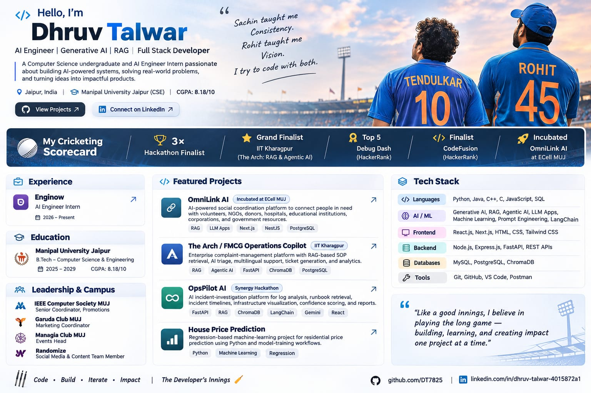
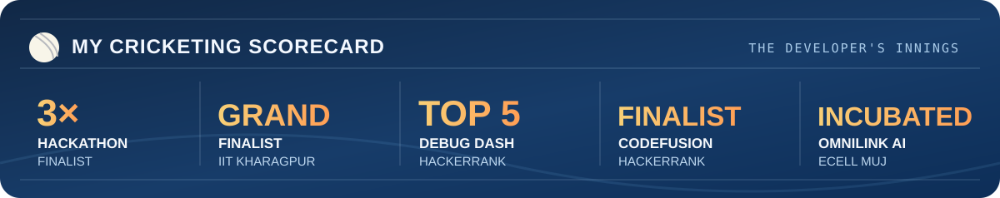

<div align="center">

<h1>Hello, I'm Dhruv Talwar 👋</h1>

<h3>🏏 Code is my pitch. Curiosity is my bat. Impact is the scoreboard.</h3>

<p><strong>AI Engineer Intern @ Enginow</strong> · <strong>3× Hackathon Finalist</strong> · <strong>Grand Finalist at IIT Kharagpur</strong></p>

<p>
  <a href="https://github.com/DT7825"></a>
  <a href="https://www.linkedin.com/in/dhruv-talwar-4015872a1/"></a>
  
</p>

</div>

---

## 🏟️ The Opening Over — Who's at the crease?

Hey, I'm **Dhruv Talwar**, a **Computer Science & Engineering undergraduate at Manipal University Jaipur (2025–2029)** and an **AI Engineer Intern at Enginow**.

I build at the intersection of **Generative AI, RAG, Agentic AI, machine learning, and full-stack development**. I enjoy taking an idea from a rough sketch to a working system — whether that means engineering retrieval pipelines, connecting LLMs to real workflows, designing REST APIs, or building interfaces people can actually use.

Cricket gave me the mindset; engineering gave me the playground. **Long innings, smart decisions, relentless practice, and the courage to go for the boundary.**

```text
PLAYER       Dhruv Talwar                 ROLE       AI / Full-Stack All-Rounder
HOME GROUND  Jaipur, India                CURRENT    AI Engineer Intern @ Enginow
ACADEMY      Manipal University Jaipur    CLASS      B.Tech CSE, 2025–2029
``` 

## 🏆 The Trophy Cabinet — Runs on the board



- 🥇 **3× Hackathon Finalist** — across hackathon competitions.
- 🏟️ **Grand Finalist — The Arch: RAG & Agentic AI Hackathon, IIT Kharagpur.**
- 🧩 **Finalist — CodeFusion, HackerRank.**
- ⚡ **Top 5 — Debug Dash, HackerRank.**
- 🚀 **OmniLink AI idea incubated at ECell MUJ.**

> **The real flex isn't one big shot. It's showing up for the next ball.**

## 🚀 Match Highlights — Projects I've worked on

### 🥇 [OmniLink AI](https://github.com/DT7825/OmniLink-AI) — Technology that connects people
**RAG · LLM Applications · Next.js · NestJS · PostgreSQL · Prisma**

An AI-powered social coordination platform designed to bring together **people in need, volunteers, NGOs, donors, hospitals, educational institutions, corporations, and government resources**.

**Milestone:** The idea was **incubated at ECell, Manipal University Jaipur**.

### 🏟️ The Arch / FMCG Operations Copilot — IIT Kharagpur
**RAG · Agentic AI · FastAPI · ChromaDB · PostgreSQL**

An AI-powered enterprise complaint-management platform with **SOP retrieval through RAG, AI complaint triage, multilingual support, ticket generation, and analytics**.

**Explore:** [Frontend](https://github.com/A-Y-U-S-H-Tech/TheArchHackathonFrontend) · [Backend](https://github.com/A-Y-U-S-H-Tech/TheArchHackathon)

### 🛠️ OpsPilot AI — Synergy Hackathon
**FastAPI · RAG · ChromaDB · LangChain · Gemini · React**

An AI incident-investigation platform for **log analysis, runbook retrieval, incident timelines, infrastructure visualization, confidence scoring, citations, and incident reports**.

**Explore:** [Frontend](https://github.com/A-Y-U-S-H-Tech/SynergyFrontend) · [Backend](https://github.com/A-Y-U-S-H-Tech/SynergyBackend)

### 🏠 House Price Prediction — The ML Fundamentals
**Python · Machine Learning · Regression**

A regression-based project for **residential price prediction**, using Python and model-training workflows.

## 🧠 The Dressing Room — My Tech Squad

| Position | Players in my squad |
| :--- | :--- |
| **🏏 Programming** | Python · Java · C++ · C · JavaScript · SQL |
| **🤖 AI / ML** | Generative AI · RAG · Agentic AI · LLM Applications · Machine Learning · Prompt Engineering · LangChain |
| **🎨 Frontend** | React.js · Next.js · HTML · CSS · Tailwind CSS |
| **⚙️ Backend** | Node.js · Express.js · FastAPI · REST APIs |
| **🗃️ Databases** | MySQL · PostgreSQL · ChromaDB |
| **🧰 Tools** | Git · GitHub · VS Code · Postman |

## 👑 Captaincy & The Team Behind the Team

**Leadership isn't just calling the shots. It's helping the entire team score.**

| Organization | Responsibility |
| :--- | :--- |
| **IEEE Computer Society, MUJ** | Senior Coordinator — Promotions |
| **Garuda Club, MUJ** | Marketing Coordinator |
| **Managia Club, MUJ** | Events Head |
| **Randomize** | Social Media & Content Team Member |

### 📚 My Current Innings

- **AI Engineer Intern, Enginow** — 2026–Present; applying GenAI, LLM-based systems, machine learning, and software engineering in practical AI work.
- **B.Tech, Computer Science & Engineering** — Manipal University Jaipur, 2025–2029.
- **CGPA:** 8.18 / 10 (as of 2026).

## 🇮🇳 The Two Legends Behind My Mindset

| 🐐 **#10 — Sachin Tendulkar** | 🏆 **#45 — Rohit Sharma** |
| :--- | :--- |
| **Discipline. Fundamentals. Consistency.** A reminder that the great innings are built one ball at a time. | **Timing. Calm. Fearless intent.** A reminder to trust preparation and step up when the challenge gets bigger. |

I admire both for different reasons. **Sachin inspires how I prepare; Rohit inspires how I approach the moment.** My own aim is to bring that same energy to technology: **build with purpose, improve with every iteration, and let the work speak.**

> **Sachin taught me consistency. Rohit taught me vision. I try to code with both.**

## 📊 The Score Never Stops

My GitHub contribution graph, pinned projects, and repository history are the **live scoreboard**. See the work, explore the code, and follow the innings as they develop.

**➡️ [Explore my repositories](https://github.com/DT7825?tab=repositories)**

## 🤝 Meet Me at the Pavilion

I'm interested in **AI engineering, useful products, open-source collaboration, and hackathons**. If you're building something ambitious, I'd love to hear about it.

**[Connect on LinkedIn](https://www.linkedin.com/in/dhruv-talwar-4015872a1/) · [Explore my GitHub](https://github.com/DT7825)**

---

<div align="center">

<h3>🏏 No shortcuts. No early declarations. Just the next great innings.</h3>

<p><strong>Built with a developer's curiosity. Inspired by a cricketer's mindset.</strong></p>

<p><code>#KeepBuilding</code> · <code>#PlayTheLongInnings</code> · <code>#AIAllRounder</code></p>

</div>
